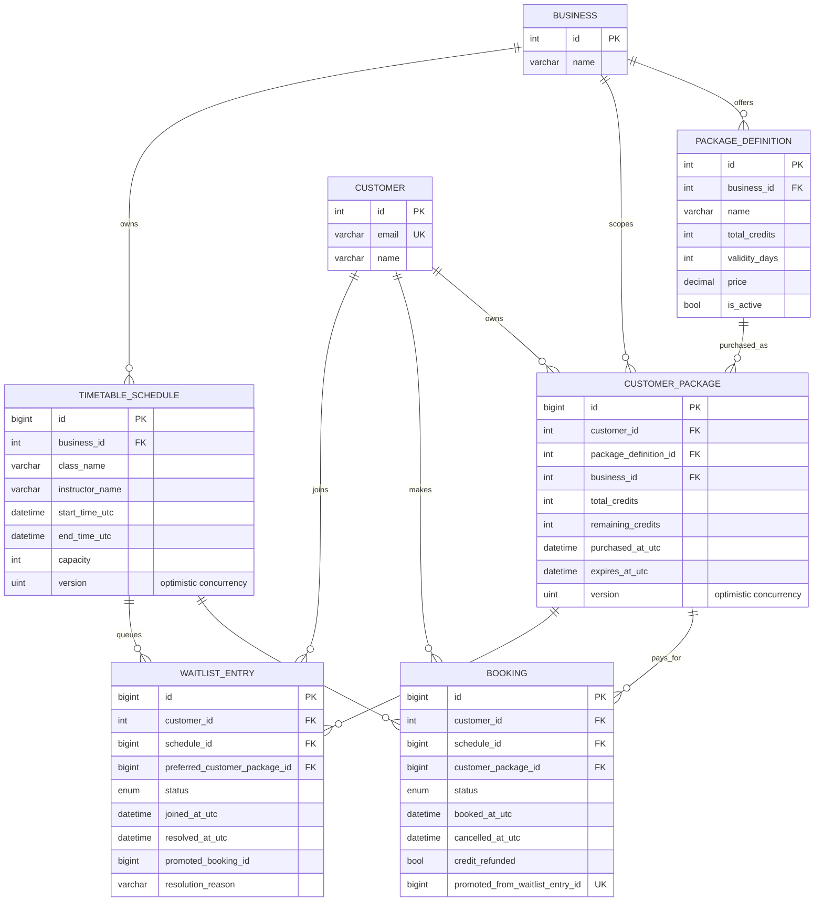

# Database schema

Important indexes:

- `bookings(schedule_id, status)` makes capacity counts efficient.
- `bookings(customer_id, status)` supports overlap validation.
- `waitlist_entries(schedule_id, status, joined_at_utc)` supports deterministic FIFO promotion.
- `customer_packages(customer_id, business_id, expires_at_utc)` supports package eligibility queries.
- `timetable_schedules(business_id, start_time_utc)` supports business/date filtering.
- `bookings.promoted_from_waitlist_entry_id` is unique, making a waitlist promotion idempotent at the database boundary.

`CustomerPackage.Version` and `TimetableSchedule.Version` are EF concurrency tokens. Credits are snapshotted on purchase so later edits to a package definition do not rewrite a customer's purchase.

